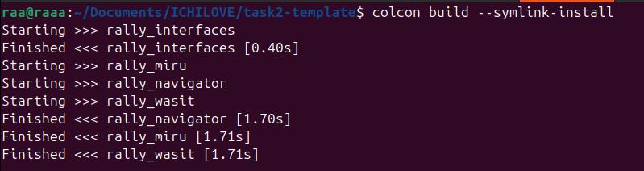
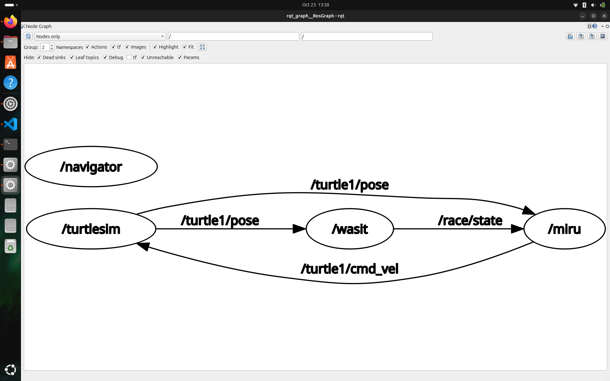
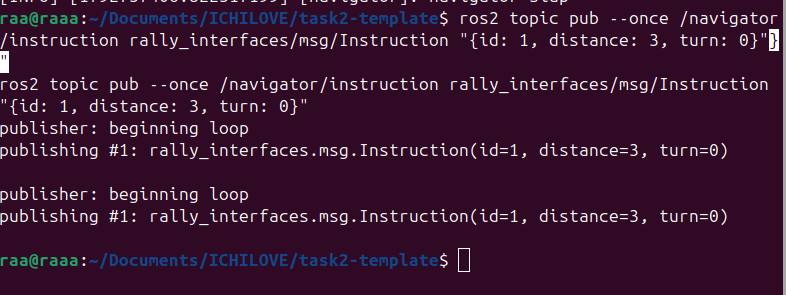
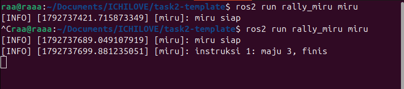
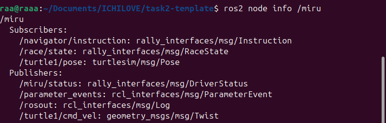
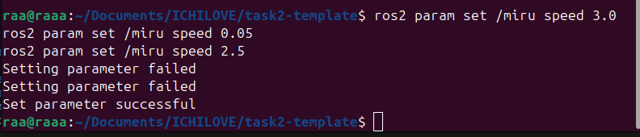
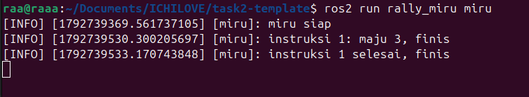
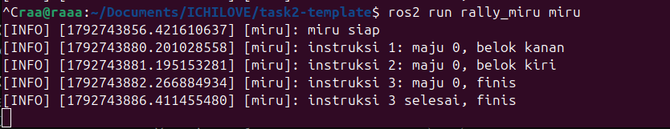
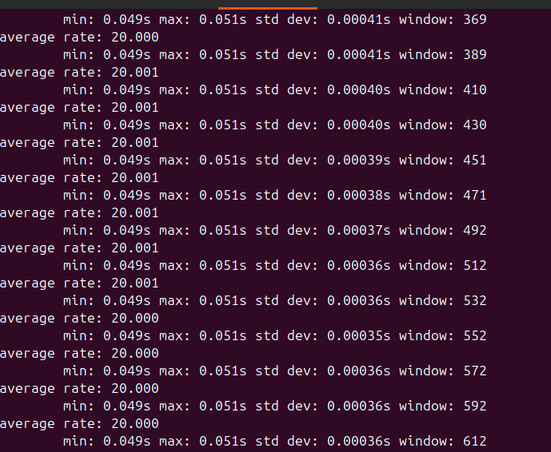

<div align=center>

|    NRP     |           Nama             | Bagian             |
| :--------: |       :------------:       | :----------------: |
| 5027261073 | Rayyan Ahmad Bahy Rachmandika   | Miru               |
| 5025261056 | Haidar Furqan Atsaqofa   | Navigator          |

# Tugas ROS2 - Reli Miru

</div>

### Daftar Soal

- [Task 1 - Persiapan ](#soal-task-1--persiapan)

- [Task 2 - Miru](/src/rally_miru/README.md)

- [Task 3 - Navigator](/src/rally_navigator/README.md)

---

# Soal Task 1 : Persiapan

Lomba reli kolam kembali digelar! Kali ini, Miru yang hanya fokus menatap ke depan harus melintasi jalur penuh batu tersembunyi. Karena tidak bisa melihat rintangan di depannya, Miru ditemani oleh seorang Coach sebagai navigator yang memegang peta, mencari jalur terbaik, dan membacakan instruksi (seperti "maju 3, belok kanan"). Miru bertugas mengeksekusi instruksi tersebut sambil terus melaporkan posisinya. Tim yang berhasil mencapai garis finis paling cepat dengan penalti paling sedikit akan keluar sebagai pemenang.

Tugas ini dikerjakan secara berpasangan dengan pembagian peran sebagai berikut:
- Task 2: Mengimplementasikan program untuk Miru.
- Task 3: Mengimplementasikan program untuk Navigator.

### Catatan Teknis

Program wasit (grader) sudah disediakan dan tidak boleh diubah. Kalian cukup melengkapi bagian kode yang ditandai dengan komentar TODO: TASK X pada kerangka kode yang telah diberikan.

## Deskripsi Sistem

```
.
├── README.md                       # soal Task 1 dan laporan praktikum
└── src
    ├── rally_interfaces            # pesan bersama
    │   └── msg/{Instruction,DriverStatus,RaceMap,RaceState}.msg
    ├── rally_wasit                 # node wasit
    ├── rally_miru                  # node miru
    │   ├── README.md               # soal Task 2
    │   ├── rally_miru/instruction_queue.py
    │   ├── rally_miru/motion.py
    │   ├── rally_miru/node/miru_node.py
    │   └── test/test_queue.py, test_forward.py, test_turn.py
    └── rally_navigator             # node navigator
        ├── README.md               # soal Task 3
        ├── rally_navigator/grid.py
        ├── rally_navigator/route.py
        ├── rally_navigator/node/navigator_node.py
        └── test/test_find_route.py, test_directions.py, test_instructions.py
```

Miru hanya mengedit `instruction_queue.py`, `motion.py`, dan `miru_node.py`. Navigator hanya mengedit `route.py` dan `navigator_node.py`. Bagian pada kode yang bertanda `Provided, do not modify` jangan diubah, termasuk seluruh package `rally_wasit` dan semua file tes.

### Aturan Lomba

- **Lintasan:** grid 10 × 10 kotak, tiap kotak 1 m. Pusat kotak (kolom `c`, baris `r`) ada di koordinat turtlesim `(c + 1, r + 1)`. Baris 0 di bawah, kolom 0 di kiri.
- **Batu:** sekitar 25 persen kotak. Ada satu kotak start di kolom 0 dan satu kotak finis di kolom 9. Lintasan dibuat acak dari parameter `seed` milik wasit, dan selalu ada jalan dengan rute terpendek minimal 12 kotak.
- **Wasit** menggambar batu (kotak merah bersilang), start (kotak biru), dan finis (kotak hijau) di kanvas turtlesim, lalu memindahkan Miru ke kotak start menghadap timur.
- **Miru tidak boleh membaca peta** dan **navigator tidak boleh membaca posisi kura-kura langsung**. Kedua node hanya boleh saling tahu lewat instruksi dan laporan. Wasit memeriksa siapa saja yang subscribe, dan mencetak `CURANG` Jika ada yang melanggar.
- Wasit menunggu Miru menyala, lalu hitung mundur 3 detik, lalu `GO!`. Wasit tidak menunggu navigator, jadi **nyalakan navigator sebelum perintah `GO!`**. Navigator yang menyala terlambat akan menyebabkan Miru sudah maju sendiri, sehingga rute dari kotak start tidak cocok lagi dengan posisinya dan lombanya bisa gagal.
- Gerakan Miru hanya dua macam: **maju lurus** sekian kotak, dan **belok 90°** di tempat ke kiri atau kanan.
- **Penalti** (ditambahkan ke waktu):

| Kejadian | Akibat |
|---|---|
| Miru bergerak sebelum `GO` | +10 detik |
| Pusat Miru masuk kotak batu | +5 detik per batu |
| Miru keluar dari grid | lomba gagal |
| Belum finis setelah 120 detik | lomba gagal |
| Pusat Miru masuk kotak finis | waktu berhenti |

### Spesifikasi Bersama

**Instruksi.** Satu `Instruction` berarti: *maju sebanyak `distance` kotak dulu, lalu belok `turn`*. `distance` boleh 0, dan instruksi terakhir memakai `TURN_NONE`. Contoh rute di peta kecil:

```
maju 3, belok kanan     {id: 1, distance: 3, turn: TURN_RIGHT}
maju 2, belok kiri      {id: 2, distance: 2, turn: TURN_LEFT}
maju 4, selesai         {id: 3, distance: 4, turn: TURN_NONE}
```

Miru memulai lomba menghadap **timur**. Jika langkah pertama rute bukan ke timur, instruksi pertama hanya berisi belokan (`distance: 0`). Putar balik 180° ditulis dua belokan kiri berturut-turut dengan `distance: 0`.

**Arah.** Empat arah berurutan berlawanan jarum jam: timur (+kolom), utara (+baris), barat, selatan. Susunan ini sudah ada di `grid.py` sebagai `DIRECTION_COL` dan `DIRECTION_ROW`.

**Urutan tetangga di BFS** harus timur, utara, barat, selatan, supaya peta yang sama selalu menghasilkan rute yang sama.

**Pengiriman instruksi.**

1. Navigator baru mengirim setelah ada rute, Miru sudah melapor sekali, dan ada yang subscribe topic instruksi. Pesan yang dikirim sebelum itu hilang.
2. Navigator menjaga `instructions_ahead` instruksi di depan `done_id`. Dengan nilai 2 dan `done_id = 4`, instruksi 5 dan 6 sudah harus terkirim.
3. Jika antrean Miru kosong, Miru berhenti menunggu (`WAITING_INSTRUCTION`). Jika tidak ada navigator sama sekali, Miru maju lurus ke arah hadapnya.
4. Miru menjalankan instruksi **berurutan menurut `id`**. Instruksi dengan `id` yang sama atau lebih kecil dari yang sudah diterima diabaikan.

### Antarmuka

| Apa | Nama | Tipe | Pengirim | Penerima |
|---|---|---|---|---|
| Peta lintasan | `/race/map` | `rally_interfaces/msg/RaceMap` | wasit | navigator |
| Status lomba | `/race/state` | `rally_interfaces/msg/RaceState` | wasit | miru |
| Instruksi| `/navigator/instruction` | `rally_interfaces/msg/Instruction` | navigator | miru |
| Laporan Miru | `/miru/status` | `rally_interfaces/msg/DriverStatus` | miru | navigator |
| Posisi kura-kura | `/turtle1/pose` | `turtlesim/msg/Pose` | turtlesim | miru dan wasit |
| Perintah gerak | `/turtle1/cmd_vel` | `geometry_msgs/msg/Twist` | miru | turtlesim |
| Kecepatan maju | parameter `speed`, bawaan 1,0 m/s, rentang 0,1 sampai 2,5 | double | operator | miru |
| Instruksi dikirim lebih dulu | parameter `instructions_ahead`, bawaan 2, rentang 1 sampai 5 | integer | operator | navigator |
| Seed lintasan | parameter `seed`, bawaan -1 (acak) | integer | operator | wasit |
| Waktu hitung mundur, batas waktu | parameter `countdown` (3,0 s), `time_limit` (120,0 s) | double | operator | wasit |

`ros2 interface show rally_interfaces/msg/DriverStatus` menampilkan isi tiap pesan lengkap dengan konstantanya.

### Contoh Output Lomba

Dengan `seed:=7`. Angka waktu boleh berbeda beberapa detik. Masing-masing node mencetak keluarannya di terminalnya sendiri.

#### Wasit:
```
[wasit] lintasan seed 7: start (0, 1), finis (9, 2), rute terpendek 18 kotak
[wasit] 3...
[wasit] 2...
[wasit] 1...
[wasit] GO!
[wasit] finish 27.3 s + penalti 0 s = 27.3 s
```

#### Miru:
```
[miru] instruksi 1: maju 0, belok kiri
[miru] instruksi 2: maju 2, belok kanan
[miru] instruksi 3: maju 2, belok kiri
...
[miru] instruksi 8: maju 4, finis
```

#### Navigator:
```
[navigator] peta diterima: 10x10, 27 batu, start (0, 1), finis (9, 2)
[navigator] rute 18 kotak, 8 instruksi
[navigator] kirim instruksi 1: maju 0, belok kiri
[navigator] kirim instruksi 2: maju 2, belok kanan
[navigator] kirim instruksi 3: maju 2, belok kiri
...
[navigator] kirim instruksi 8: maju 4, finis
```

Awalan ROS (`[INFO]` dan timestamp) dihilangkan dengan `export RCUTILS_CONSOLE_OUTPUT_FORMAT='[{name}] {message}'`, yang dijalankan sekali di setiap terminal.

## Soal (_Tasks_)

### A. Setup Workspace _(5 Points)_

Build workspace, jalankan keempat node, lalu buktikan semuanya terhubung.

```bash
source /opt/ros/jazzy/setup.bash
colcon build --symlink-install
source install/setup.bash

export RCUTILS_CONSOLE_OUTPUT_FORMAT='[{name}] {message}'   # di setiap terminal

# terminal 1
ros2 run turtlesim turtlesim_node
# terminal 2
ros2 run rally_wasit wasit --ros-args -p seed:=7
# terminal 3
ros2 run rally_navigator navigator
# terminal 4
ros2 run rally_miru miru
```

Dengan `--symlink-install`, perubahan kode Python langsung berlaku tanpa `colcon build` ulang, node cukup dijalankan ulang.

#### Contoh Output:
```
[wasit] wasit siap
[navigator] navigator siap
[miru] miru siap
[wasit] menunggu miru...
```

Kanvas turtlesim terisi batu, start, dan finish, dan `rqt_graph` menampilkan keempat node.

Note : Di kerangka awal, wasit akan terus mencetak `menunggu miru...`, karena lomba baru dimulai setelah Miru memasang publisher laporannya (Task 2). Wasit tidak menunggu navigator untuk memulai permainan. Akibatnya Miru maju lurus ke timur dan lomba tetap dinilai. Jalankan `source install/setup.bash` di setiap terminal baru.

## Berkas Pengumpulan

1. Repositori yang berisi source code dari `rally_miru` dan `rally_navigator` yang sudah dilengkapi.
2. `README.md` di root dengan laporan yang sudah diisi, beserta folder `screenshots/`.
3. **Penggunaan AI diperbolehkan**, namun harus dinyatakan dengan jelas untuk apa dan bagian mana yang ditulis menggunakan bantuan AI.

## Tips Umum

- Jalankan wasit dengan `-p seed:=7` supaya lintasannya sama setiap kali, dan coba banyak seed sebelum yakin.
- Nama topic dan parameter sudah tersedia sebagai konstanta di bagian atas file (`..._TOPIC`, `..._PARAM`). Jadi kalian bisa memanfaatkan konstanta itu.
- `ros2 node list`, `ros2 topic list`, dan `ros2 param list` memberi tahu apa saja yang sebenarnya berjalan.

---

### Laporan Resmi Praktikum

Tulis laporan di template berikut! Tidak perlu terlalu teknis sampai kode atau nama fungsi, cukup jelaskan dengan kalimat sendiri.

Penggunaan AI: Claude dipakai untuk menjelaskan soal dan error lalu bantu penjelasan dandebugging task-tasknya, untuk kodenya kami jalankan dan debugging sendiri. 
---

# Task 1 - Persiapan dan Lomba

## A. Setup Workspace

### Langkah-langkah
Workspace di-build dengan `colcon build --symlink-install`, lalu di-source dengan `source install/setup.bash` di setiap terminal. Setelah itu turtlesim, wasit, navigator, dan Miru dijalankan di terminal terpisah, dan koneksinya dicek lewat `rqt_graph`. Wasit tetap mencetak "menunggu miru..." pada tahap awal karena publisher laporan Miru belum ada.

### Screenshot




# Task 2 - Miru

## A. Antrean Instruksi

### Langkah-langkah
Dibuat antrean yang menyimpan instruksi dan menolak instruksi yang nomornya sama atau lebih kecil dari nomor terakhir yang diterima. Miru subscribe ke topic instruksi dan memasukkan tiap pesan ke antrean. Instruksi 1 dikirim dua kali, tetapi lognya hanya muncul sekali.

### Screenshot



## B. Pose dan Perintah Gerak

### Langkah-langkah
Dibuat publisher untuk perintah gerak ke `/turtle1/cmd_vel` dan subscriber untuk posisi dari `/turtle1/pose`, yang menyimpan pose terbaru. Hasilnya dicek dengan `ros2 node info /miru`.

### Screenshot


## C. Aba-aba GO dan Parameter

### Langkah-langkah
Miru subscribe ke status lomba untuk tahu kapan GO. Parameter `speed` didaftarkan dan nilai di luar 0,1 sampai 2,5 ditolak. Dicoba dengan `ros2 param set` untuk 3.0 (ditolak), 0.05 (ditolak), dan 2.5 (diterima).


### Screenshot


## D. Maju

### Langkah-langkah
Titik tujuan dihitung dari posisi rencana, bukan posisi nyata, supaya galat tidak menumpuk antar instruksi. Kura-kura maju sampai sisa jarak ke tujuan nol atau negatif, lalu berhenti. Instruksi maju 3 kotak membuat kura-kura maju sekitar 3 m dan Miru mencetak "selesai, finis".

### Screenshot


## E. Belok

### Langkah-langkah
Arah tujuan dihitung dengan menambah 90 derajat untuk belok kiri atau mengurangi 90 derajat untuk belok kanan, lalu dirapikan agar tetap di rentang -π sampai π. Kura-kura berputar sampai selisih sudutnya cukup kecil. Hasilnya dicek lewat nilai `theta` (sekitar 1.57 setelah belok kiri, sekitar 0 setelah belok kanan).

### Screenshot


## F. Laporan Status

### Langkah-langkah
Dibuat publisher status dan timer 20 kali per detik yang mengirim state, posisi, arah, nomor instruksi, dan jumlah antrean. Laporan tidak dikirim sebelum pose pertama datang. `ros2 topic hz /miru/status` menunjukkan sekitar 20 Hz.

### Screenshot


## G. Bonus: Berhenti Lebih Tepat

### Langkah-langkah
Jelaskan langkah-langkah yang dilakukan.

-

### Screenshot
Masukkan screenshot hasil eksekusi program atau proses yang relevan, termasuk tabel hasil ukur.

# Task 3 - Navigator

## A. Menerima Peta

### Langkah-langkah
Jelaskan langkah-langkah yang dilakukan.

-

### Screenshot
Masukkan screenshot hasil eksekusi program atau proses yang relevan.

## B. Mencari Rute

### Langkah-langkah
Jelaskan langkah-langkah yang dilakukan.

-

### Screenshot
Masukkan screenshot hasil eksekusi program atau proses yang relevan.

## C. Rute Menjadi Arah

### Langkah-langkah
Jelaskan langkah-langkah yang dilakukan.

-

### Screenshot
Masukkan screenshot hasil eksekusi program atau proses yang relevan.

## D. Arah Menjadi Instruksi

### Langkah-langkah
Jelaskan langkah-langkah yang dilakukan.

-

### Screenshot
Masukkan screenshot hasil eksekusi program atau proses yang relevan.

## E. Mengirim Instruksi

### Langkah-langkah
Jelaskan langkah-langkah yang dilakukan.

-

### Screenshot
Masukkan screenshot hasil eksekusi program atau proses yang relevan.

## F. Parameter instructions_ahead

### Langkah-langkah
Jelaskan langkah-langkah yang dilakukan.

-

### Screenshot
Masukkan screenshot hasil eksekusi program atau proses yang relevan.

## G. Bonus: DFS lawan BFS

### Langkah-langkah
Jelaskan langkah-langkah yang dilakukan.

-

### Screenshot
Masukkan screenshot hasil eksekusi program atau proses yang relevan, termasuk tabel hasil ukur.
